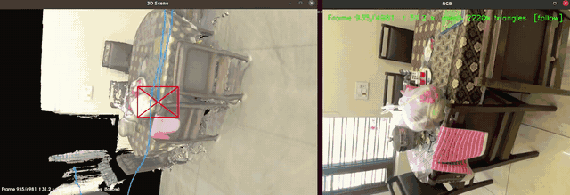
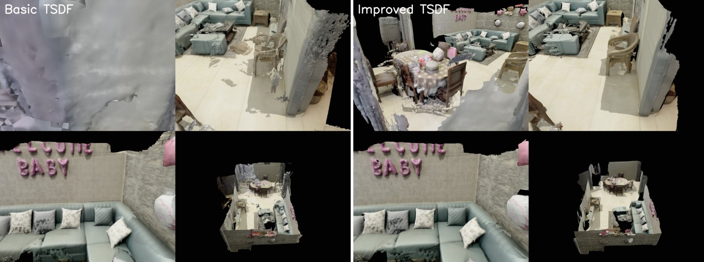
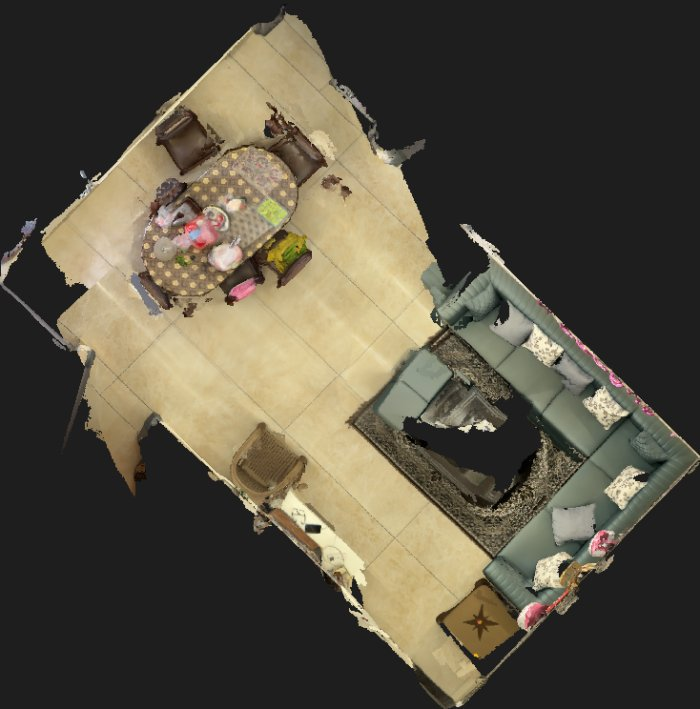

# RGB-D + IMU SLAM from Scratch: Phone Video → Accurate 3D Model

A C++ pipeline that turns a handheld phone recording (RGB video + aligned depth + IMU) into an accurate camera trajectory and a detailed, metric-scale 3D mesh of the scene.

The data was recorded with an **iPhone 16 Pro** (LiDAR depth) using the **Spectacular Rec** app (Spectacular AI). The code reads the app's recording format directly; no conversion step is needed.



*Left: the reconstructed mesh with the camera (red) moving along its estimated trajectory (blue). Right: the live camera image.*

▶️ Videos:
- [Part 2: RGB-D + IMU SLAM, drift reduction and 3D mesh](https://www.youtube.com/watch?v=2Xeik0asszk) (this repository)
- [Part 1: RGB-D SLAM from Scratch](https://youtu.be/I0OaAT-vNGM)

---

## Pipeline

Three programs, run in order. Each takes the recording folder as its argument.

| Step | Program | What it does |
|---|---|---|
| 1 | `vio_slam` | Visual-inertial SLAM: dense RGB-D tracking fused with IMU, keyframes, loop closure, pose-graph optimization, bundle adjustment, plus a dense reprojection check of **every** frame pose with automatic refinement |
| 2 | `map_builder` | 3D reconstruction: quality-weighted TSDF fusion and marching cubes to a clean, coloured mesh |
| 3 | `scene_player` | 30 FPS playback of the camera trajectory inside the mesh (or a growing point cloud), alongside the camera image |

### 1. `vio_slam`: trajectory estimation
- **Dense direct RGB-D alignment** of every frame against the current keyframe: photometric + depth residuals over all valid pixels, a 3-level pyramid, Huber weights and Gauss-Newton on SE(3). Fallbacks: ORB + 3D-3D RANSAC re-initialization, then IMU-only prediction.
- **IMU preintegration** (on-manifold, Forster et al.) with bias Jacobians; IMU initialization estimates the gyro bias, the gravity direction and velocities.
- **Sliding-window visual-inertial bundle adjustment** (Ceres): dense relative-pose factors, IMU factors and landmark reprojection + depth factors.
- **Loop closure**: candidate keyframes → ORB matching → 3D-3D RANSAC → dense verification → global pose-graph optimization. After tracking, dense-verified **revisit constraints** are added and a final global BA is run.
- **Verification**:
  - every keyframe pair (consecutive, loop, revisit) is re-aligned densely, starting from the estimated pose;
  - **every frame** is checked against a keyframe it was *not* tracked against;
  - odd-numbered keyframes are **held out** (never used as revisit constraints), giving an honest test of global accuracy.
- **Automatic refinement**: keyframe intervals with failing frames get new dense constraints and are re-optimized. A round is kept only if more frames pass **and** the held-out check does not get worse; otherwise it is rolled back.
- Optional `--live` view: the RGB image and the 3D scene being built while SLAM runs.

### 2. `map_builder`: 3D mesh
- **Depth clean-up per frame**: depth edges (flying pixels) and depth under blown-out colour are dropped; an edge-preserving filter scaled to the depth noise is applied.
- **Quality-weighted TSDF fusion** (6 mm voxels, voxel hashing): each depth pixel is weighted by its distance (noise grows with z²) and viewing angle. Only frames whose pose **passed** the per-frame check are fused. Colour comes from voxels near the surface, and blurry frames count less.
- **Marching cubes** on the sparse voxel blocks (VTK case table; verified on an analytic sphere: watertight, outward normals, 0.06 mm error). A triangle is created only where the surface was seen at least 3 times with enough quality.
- **Clean-up**: small disconnected fragments are removed and **Taubin smoothing** is applied (smoothing without shrinkage).
- **Outputs**: a full-detail coloured mesh, a lighter coloured mesh for viewing, and a top-down view. The floor plane is fitted to level the top view and to report floor flatness.

### 3. `scene_player`: visualization
- A fixed 30 FPS playback with a decode thread, so the frame rate stays constant as the scene grows.
- `--mesh` shows the camera moving through the finished mesh.
- It starts paused, so the windows can be arranged first (e.g. for screen recording).

---

## Results

166-second handheld recording of a living room, ~50 m camera path, 4,982 frames.

**Trajectory** (`vio_slam`, ~6 min on a laptop):

| Check | Odometry only | Final |
|---|---|---|
| Loop-closure pairs: median pose error | 159 mm | **3.8 mm** |
| Held-out revisit pairs (never used as constraints): median error | 65 mm | **12 mm** |
| Consecutive keyframes passing the dense check | 98% | 96% |

- **Every frame checked:** 96.5% pass (median pose offset 3.2 mm / 0.11°).
- All 4,982 frames were tracked densely, with 18 loop closures and 152 revisit constraints.

**Mesh** (`map_builder`, ~2.5 min, 3 GB of RAM, CPU only):



| | Basic TSDF | Improved TSDF |
|---|---|---|
| Surface roughness (median normal deviation) | 15.6° | **4.5°** |
| Loose fragments | 9,371 pieces | **3,793 pieces** |



---

## Recording the data

- **Device:** iPhone 16 Pro (RGB camera + LiDAR depth + IMU)
- **App:** Spectacular Rec by Spectacular AI (iOS), which records synchronized RGB video, aligned depth and IMU data
- **Format:** the app's recording folder is used as-is:

```
<recording>/
  data.mov            RGB video (1920x1440, 30 FPS)
  frames2/*.png       16-bit depth in mm (256x192), aligned to the RGB
  data.jsonl          per-frame timestamps + intrinsics, gyroscope + accelerometer (~100 Hz)
  calibration.json    image size + IMU-to-camera transform
  metadata.json       device model
```

Tips for a good recording: move slowly (especially when turning), keep surfaces within ~0.3–2.5 m, cover each area from several directions, and come back to places you have already recorded, ideally from a similar direction (this gives loop closures).

## Build

Dependencies: C++17, CMake ≥ 3.18, OpenCV with CUDA (`cudafeatures2d`, used for ORB), Eigen 3, PCL 1.10 (visualization), VTK 7.1, Ceres Solver, OpenMP.

```bash
mkdir build && cd build
cmake ..
make -j8
```
`CMakeLists.txt` points to a local OpenCV / CUDA install (`OpenCV_DIR`, `CONDA_LIB`, `CUDA_TOOLKIT_ROOT_DIR`). Adjust these paths for your machine.

## Workflow

**1. Record** the scene with Spectacular Rec on the iPhone (see the tips above).

**2. Copy the recording folder to the computer**, e.g. via AirDrop, the Files app or USB. Keep each recording in its own folder (with `data.mov`, `frames2/`, `data.jsonl`, ...), for example:
```
~/3D/recording_2026-10-04_11-24-56/
```

**3. Build once** (see [Build](#build)).

**4. Estimate the camera trajectory:**
```bash
cd build
./vio_slam ~/3D/recording_2026-10-04_11-24-56
```
This takes about 6 minutes for a ~3-minute recording. When it finishes, check the summary it prints, or `slam_results_vio/frame_quality_summary.txt`: the PASS percentage shows how many frame poses passed the dense check, and the longest failing stretches show where the recording was hard. Add `--live` to watch the scene being built while it runs.

**5. Build the 3D mesh:**
```bash
./map_builder ~/3D/recording_2026-10-04_11-24-56
```
This takes about 2–3 minutes and writes the mesh to `reconstruction/`. Use `--voxel 0.008` if memory is tight.

**6. View the result:**
```bash
./scene_player ~/3D/recording_2026-10-04_11-24-56 --mesh
```
It opens paused on the first frame: arrange the windows, then press SPACE. Keys: SPACE start/pause, V follow camera / free view, Q quit. Without `--mesh`, it shows the scene growing as a point cloud instead. The mesh can also be opened in any mesh viewer, e.g. `meshlab reconstruction/room_mesh.ply`.

The recording can be given as a full path, or just as the folder name if it sits next to the default `DATASET_DIR` set at the top of each `.cpp` file.

## Main outputs

| File | Content |
|---|---|
| `slam_results_vio/trajectory_tum.txt` | Camera pose of every frame (TUM format: `t tx ty tz qx qy qz qw`) |
| `slam_results_vio/frame_quality.txt` | Dense pose check of every frame (PASS / CHECK) |
| `slam_results_vio/verification.txt` | Keyframe, loop and held-out checks |
| `reconstruction/room_mesh.ply` | Full-detail coloured mesh |
| `reconstruction/room_mesh_light.ply` | Lighter coloured mesh (~1 cm), used by `scene_player --mesh` |
| `reconstruction/top_view.png` | Coloured top-down view |

World frame: metres, z up (gravity along −z), with `p_world = R · p_camera + t`.

## Limitations
- **Offline:** tracking runs at ~29 FPS, but the final optimization, verification and meshing happen after the recording.
- **Large view changes at revisits:** revisits seen from very different viewing angles (> ~20°) are hard to constrain, so some revisited areas keep 2–5 cm of error.
- **Coarse phone depth:** depth is 256×192, so thin objects and fine detail are limited, and glass and mirrors produce missing or wrong depth.
- **No external ground truth yet:** accuracy figures come from self-consistency checks (dense re-alignment, held-out pairs), not a motion-capture reference.

## Next
- Neural surface reconstruction and Gaussian splatting for higher-quality models
- Multi-recording consistency, and evaluation against motion-capture ground truth
